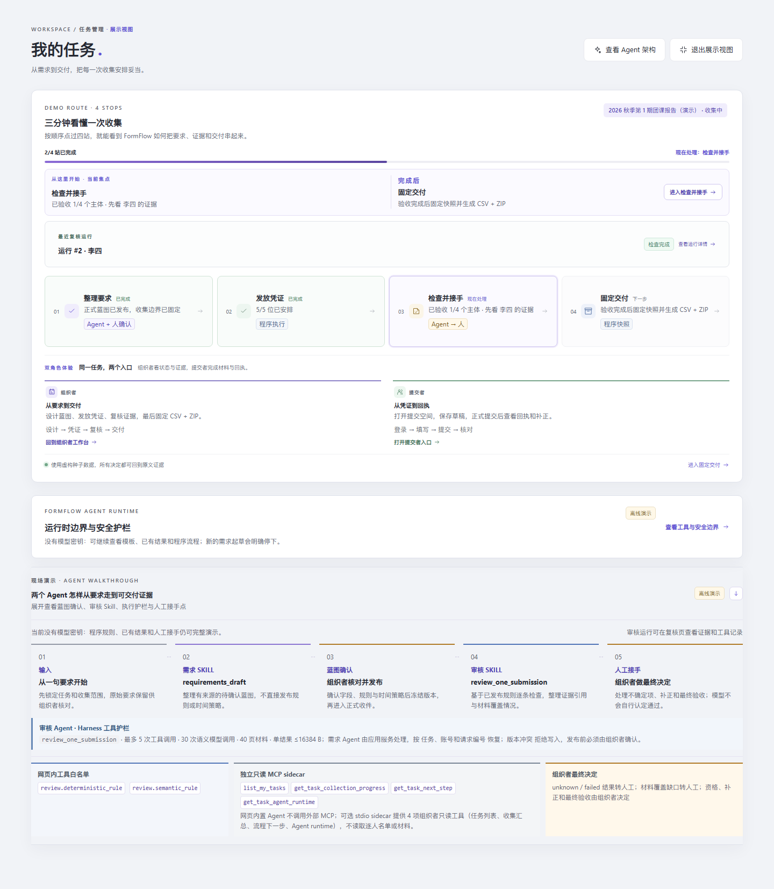
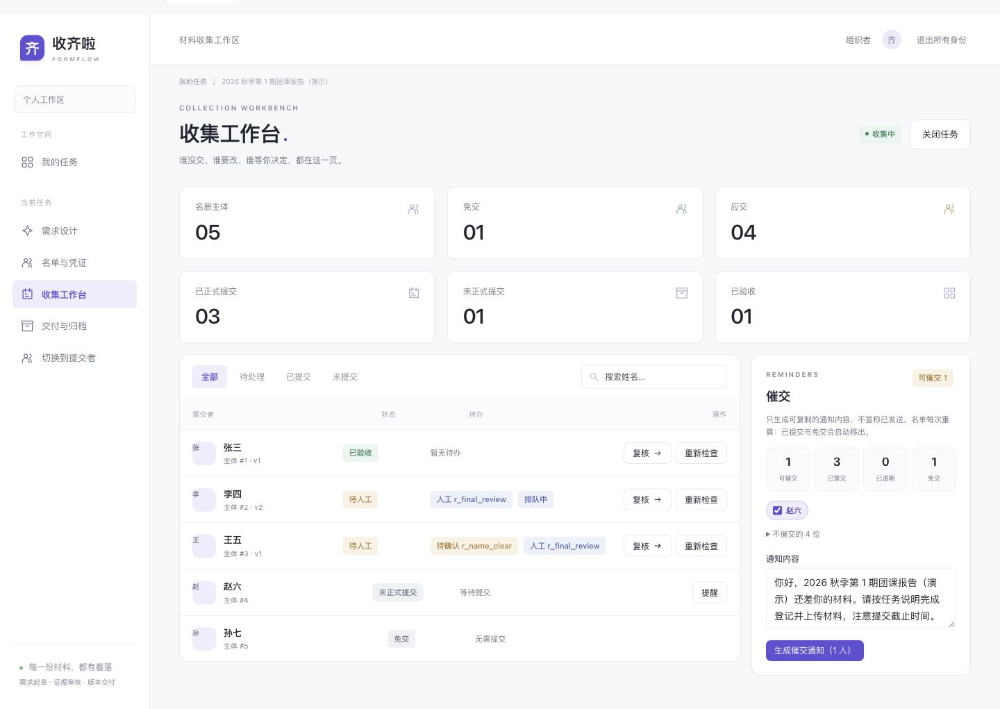

<div align="center">

# FormFlow · 收齐啦

### 每一份材料，都有着落。

从一句收集要求，到一份可追溯的交付包。
**要求可执行 · 补正有证据 · 人工有边界 · 交付按版本**

[快速开始](#快速开始) · [五分钟演示](docs/demo-guide.md) · [产品路线](docs/product-roadmap.md) · [交互与验收记录](docs/interaction-optimization.md)

</div>



> 当前为本地可演示的黑客松作品，已实现从发布要求、收件、检查、补正到人工验收及快照交付的核心闭环。尚未完成真实业务试点、模型质量评估和公网部署安全验收；截图与演示人物、材料均为虚构。

## 为什么做收齐啦

报名、团课报告、比赛材料……难点通常不在“做一张表单”，而在后面：**谁没交、谁要改、哪一版算数、最后交出去的是不是验收过的那一份？**

FormFlow 以一次「收集任务」为单位，把散落的要求变成结构化蓝图。组织者负责确认要求与最终判断，程序负责权限、版本与交付一致性，两个 Agent 协助整理要求、逐条找证据，而不是替人宣布“全部通过”。

### 一条完整工作流

| 步骤 | 你会看到什么 | 为什么重要 |
| --- | --- | --- |
| ① 说明要求 | 需求设计台：起草、澄清、历史版本、发布前差异核对 | 模型草案不直接发布，不暗加要求 |
| ② 安排收集 | 名单与凭证、开放报名入口、个人/团队主体 | 按稳定主体 ID 管理，不靠姓名猜权限 |
| ③ 填写与提交 | 默认完整表单、可选逐步引导、缺项定位、正式回执 | 上传 ≠ 保存草稿 ≠ 正式提交 |
| ④ 检查与补正 | 规则结果、原文位置、覆盖缺口、提交者解释 | “没读到”不能当成“确认缺失” |
| ⑤ 人工复核 | 规则决定、独立资格核实、单独验收当前版本 | 确认问题仍需补正；免交不等于验收 |
| ⑥ 交付归档 | 固定快照的 CSV 与 ZIP、排除原因、版本记录 | 打包期间的新提交不偷偷替换原包 |



## 两个 Agent，各守边界

```text
原始要求 ─→ 持久请求队列 → 需求 Agent → 蓝图草案 → 程序校验 + 人工确认发布
                                      │
字段 / 附件 ─→ 正式版本与回执 ─→ 后台 Worker
                                      │
                         确定性规则 + 审核 Agent
                                      │
                         逐条证据 / 未完成项 / 补正建议
                                      │
                         人工决定 → 资格核实 → 本版本验收
                                      │
                               固定快照 CSV + ZIP
```

- **需求 Agent**：把自然语言整理为字段、材料槽位、规则和时间策略；澄清不确定项。发布仍需人确认。
- **审核 Agent**：按已发布规则核对材料；语义结论须引用可定位的原文，证据不足为 `unknown`，技术失败为 `failed`。
- **程序**：管理私有访问、收件校验、幂等回执、不可变正式版本、截止判断、预算与快照。
- **人**：判断例外、核实资格、处置争议并验收。不做思想/文笔打分、资格真实性认定或 AI 写作检测。

## 这一轮的交互改进

- **理由刷新不丢**：规则理由、资格依据、验收依据独立暂存于本标签页，最长 7 天、最多 50 个复核范围。不是已提交决定，也不是跨设备服务器草稿；关闭标签页后不保证保留，退出登录清除。
- **旧理由不串用**：账号、任务、主体、正式修订、发布蓝图、登记成员及检查运行共同确定复核范围。范围变化后不自动恢复旧理由，旧页面提交返回冲突；存储不可用时明确提示刷新风险。
- **复核有顺序**：材料 → 资格 → 验收三步快捷入口；“下一待处理”保留当前输入，规则证据后紧接决定表单；规则很多时可切换“只看待处理”，处理完仍能回看全部历史。
- **决定不混淆**：“确认问题”保留补正待办；“人工核对通过 / 纠正误报 / 批准例外”只处置当前规则，之后仍需单独验收。
- **提交错误可定位**：缺项摘要跳到具体字段或附件；保存失败、版本冲突不会静默覆盖本地输入。
- **组织者待办不让提交者空等**：需要人工核对时明确说明无需重复提交；页面打开期间每 30 秒检查一次，临时服务故障后继续同步，网络恢复时立即重试；正式版本和回执保留，组织者完成后展示下一步。
- **提交后快速查看进度**：正式回执上方提供“查看核对记录”入口。正式提交后，核对结果会排在回执与可编辑表单之间；点击入口还会定位结果区并移动键盘焦点，避免结果卡片贴在长表单末尾时被文档底部限制在视口下沿。桌面端为粘性导航栏留出滚动间距，结果区也关联标题供辅助技术识别。
- **设计输入可恢复**：未发送的要求与澄清按账号、任务、蓝图基线隔离；发布前核对差异，阻止过时基线发布。
- **展示任务上下文可被辅助技术识别**：当前任务、路线焦点与操作入口作为有名称的语义分组播报，不依赖视觉布局猜测它们之间的关系。
- **设计台对话区更紧凑**：桌面端缩短空白聊天视口，长对话仍在记录区内滚动；窄屏继续使用原有单列尺寸。

## 快速开始

### 一键启动演示环境（推荐）

```bash
git clone https://github.com/strawberry-little-bear/FormFlow.git
cd FormFlow
python scripts/start_demo.py
```

脚本自动完成依赖安装、种子数据写入并启动 API 和 Worker；只有 API 健康检查通过、Worker 完成启动恢复并报告就绪后，才显示可访问提示。启动后打开输出中的本地地址，组织者用 `demo / demo1234` 登录；登录页的“体验演示环境”入口会自动登录并进入展示视图，窄屏下也放在账号输入框之前。若默认 8000 端口被其他服务占用，可运行 `python scripts/start_demo.py --port 8010`。

首次启动会在 `data/demo/` 创建独立数据库并打印提交者凭证；后续启动会保留现有演示数据和凭证。执行 `python scripts/start_demo.py --check` 可只读检查依赖、种子、API 健康、Worker `ready` 标记、Agent runtime 合同和 MCP 只读桥；任一关键项未就绪时返回非零，不会安装依赖或写入数据。需要恢复初始场景时，确认只操作本地演示数据后运行 `python scripts/start_demo.py --reset`；重置会删除 `data/demo/` 下的数据库、附件和日志并重新显示凭证。

演示服务启动后，可用浏览器 Harness 对评委展示链做一次只读验收：

```bash
FORMFLOW_SHOWCASE_BASE=http://127.0.0.1:8000 node scripts/showcase_check.cjs
```

它会在 1440、1366、390、320px 下走登录、展示首页、需求设计、工作台、复核、交付和两个无效 ID 失败态；检查关键入口、展示模式退出后的任务列表可见性与键盘焦点、加载占位是否被替换、横向溢出、控制台错误及非预期 HTTP 失败。将 `FORMFLOW_SHOWCASE_OUT` 设为输出目录后，报告会写入该目录下的 `showcase-results.json`，每条路由还会保存对应视口截图到 `screenshots/<视口>/<路由>.png`；报告记录实际 URL hash 与页面标题，并在路由不匹配或缺少标题时判失败，避免截图和验收路由错配。该脚本只读访问演示服务，不创建或修改任务数据。

提交者完整流程使用独立走查脚本，并会实际上传、保存和提交虚构材料，因此只能指向隔离的演示数据库：

```bash
FORMFLOW_WALKTHROUGH_CREDENTIAL=your-demo-token node scripts/ux_submitter_full_walkthrough.cjs
```

该流程覆盖凭证登录、表单、附件、服务器草稿恢复、正式提交和回执；在桌面与 320px 手机视口点击“查看核对记录”，验证焦点、可访问名称及结果标题未被粘性导航栏遮住。报告和截图默认写入 `docs/ux-review-2026-10-25/submitter-full/`，也可用 `FORMFLOW_WALKTHROUGH_OUT` 指定输出目录。

API 与 Worker 日志保存在 `data/demo/logs/`。停止命令只处理启动器登记的演示进程；若 8000 端口被其他程序占用，启动会报错且保留现有演示数据。

停止服务：`python scripts/start_demo.py --stop`。停止命令会使用启动器记录的 API 与 Worker 进程，不依赖端口参数。

### 备份与恢复演练

演示数据需要在服务停止后备份，工具会将 SQLite 数据库和私有附件打包并逐文件校验。它不会覆盖已有备份或恢复目录；恢复只写入一个新的目标目录，不会替换 `data/demo/`：

```bash
python scripts/start_demo.py --stop
python scripts/backup_demo.py create --output data/backups/demo-check.zip
python scripts/backup_demo.py verify data/backups/demo-check.zip
python scripts/backup_demo.py restore data/backups/demo-check.zip --target data/demo-restore-check
```

`verify` 会在临时目录实际展开备份并运行 SQLite 完整性检查，同时核对清单记录的创建时间、数据库/附件来源、文件大小和 SHA-256。恢复只在全部文件校验通过后原子地改名到目标目录；失败会清理临时目录，不会留下半成品。备份 ZIP 未加密，只用于虚构演示数据，应保存在私有目录并避免提交到仓库。恢复目录通过校验后可作为隔离副本检查；此工具不替代正式部署的异地备份、附件存储快照或灾难恢复方案。

### 连接外部 MCP 客户端（只读）

FormFlow 提供一个可选的本地 stdio MCP sidecar，供支持 MCP 的桌面 Agent 查询组织者自己的任务、聚合收集进度、下一步路线和 Agent runtime 合同。外部 Agent 可以先读取某任务启用的 Skill、工具白名单、Harness 限额、MCP 边界及人工接手点，再决定如何协助组织者。它调用同一 API，并复用组织者登录会话，因此任务所有权仍由服务端验证。当前只开放 `list_my_tasks`、`get_task_collection_progress`、`get_task_next_step` 与 `get_task_agent_runtime`；进度工具只返回名单/开放报名的计数，不读取逐人名单、材料、提示词或审计正文，也不提供写入工具。

任务首页另外展示一条由服务端执行的 MCP-compatible 只读导览：它会按同一白名单生成四个调用的脱敏账本、运行编号和人工接手边界，供现场解释 Agent 如何读取任务状态。浏览器不会拿到 MCP 会话 token，也不会直接启动 stdio sidecar；这条网页导览和下面的外部 MCP 客户端是两条独立入口。

想现场验证 MCP 协议和四项工具，可在 API 已启动并完成种子数据后另开终端运行交互演示。脚本通过隐藏输入收取组织者密码，token 只在当前进程及其 sidecar 子进程环境中使用，不会打印或写入文件：

```bash
python scripts/demo_mcp.py
```

默认账号是 `demo`，按提示输入 `demo1234`。脚本会通过 MCP stdio 发现工具，再调用任务列表、收集进度、下一步路线和 Agent runtime 查询；收集进度会汇总显示资格待核人数。账号下只有一个任务时自动选择，多任务时可输入任务编号，直接回车使用列表第一项。需要在录屏或无 stdin 的环境复现时，可把密码放入当前进程环境变量后运行 `FORMFLOW_DEMO_PASSWORD=demo1234 python scripts/demo_mcp.py --non-interactive --task-id 1`；PowerShell 对应为 `$env:FORMFLOW_DEMO_PASSWORD='demo1234'; python scripts/demo_mcp.py --non-interactive --task-id 1`。密码、会话 token 和材料内容都不会打印或写入文件。输出只含任务导航摘要与运行边界。HTTP 仅允许本机地址，远程 API 必须使用 HTTPS。

桌面 MCP 客户端可按下面示例配置 sidecar。不要把真实账号 token 提交到仓库或发给他人：

```json
{
  "mcpServers": {
    "formflow": {
      "command": "python",
      "args": ["-m", "app.mcp_server"],
      "cwd": "替换为 FormFlow 项目目录",
      "env": {
        "FORMFLOW_MCP_API_URL": "http://127.0.0.1:8000",
        "FORMFLOW_MCP_TOKEN": "替换为组织者登录 token"
      }
    }
  }
}
```

远程 API 地址必须使用 HTTPS；HTTP 仅允许 loopback。登录 token 失效后需更新 MCP 客户端配置。网页内置 Agent 不会自动调用此 stdio sidecar；网页上的只读导览由服务端桥接并按脱敏投影展示。

### 手动安装（如需单独配置）

本轮在 Python 3.12 验证；建议使用 Python 3.12。前端为原生 HTML/CSS/JavaScript，无需 Node 构建；Node 仅用于前端契约测试。

```bash
git clone https://github.com/strawberry-little-bear/FormFlow.git
cd FormFlow
python3 -m venv .venv
source .venv/bin/activate
python -m pip install --require-hashes -r requirements.lock
```

`requirements.txt` 记录兼容版本范围，`requirements.lock` 固定本项目 Python 3.12 的解析结果与包哈希。锁文件由 `uv 0.13.5` 生成；更新依赖后，在 Python 3.12 环境运行 `uv pip compile --generate-hashes --python-version 3.12 --universal --output-file requirements.lock requirements.txt`，再用 `python -m pip install --require-hashes -r requirements.lock` 验证安装，并运行完整测试。

### 手动启动独立演示环境（无需模型密钥）

**种子脚本会重置同名演示任务、演示凭证及相关附件。不要对业务库执行。** 以下使用单独数据库和存储目录：

```bash
export FORMFLOW_DATABASE_URL="sqlite:///$PWD/data/demo/formflow.db"
export FORMFLOW_STORAGE_DIR="$PWD/data/demo/storage"
export FORMFLOW_LLM_API_KEY=''
python scripts/seed_demo.py
uvicorn app.main:app --host 127.0.0.1 --port 8000 --reload
```

浏览器打开 `http://127.0.0.1:8000/`。组织者：`demo / demo1234`；提交者使用种子脚本打印的对应虚构人物凭证。凭证是访问密钥，不要公开真实业务凭证。

**演示边界**：种子用脚本化模型预生成已有检查结果，可离线演示证据、人工决定、统计与交付。没有真实模型配置时，**AI 起草与新提交的语义审核不能完整工作**，不应把未完成检查演示成通过。

### 3. 新提交检查需要 Worker

API 负责可靠记录检查意图，Worker 才执行检查。另开终端，使用**同一个虚拟环境、数据库和存储目录**：

```bash
# 如果当前终端已经在 FormFlow 根目录，跳过 cd
cd /path/to/FormFlow
source .venv/bin/activate
export FORMFLOW_DATABASE_URL="sqlite:///$PWD/data/demo/formflow.db"
export FORMFLOW_STORAGE_DIR="$PWD/data/demo/storage"
export FORMFLOW_LLM_API_KEY=''
python -m app.worker
```

不开 Worker，新提交会停留在排队状态；需求 Agent 请求仍由 API 的后台任务尝试处理，页面会按同一请求编号查询状态。若 API 在排队后中断，页面轮询会重新触发仍排队的请求；Worker 重启时也会回收超过该环境模型调用上限的卡住任务。每个任务串行处理草案，旧版本冲突会停止而不覆盖新草案。无密钥时确定性检查仍可执行，语义检查明确记录未完成，而不是阻止收件或虚构全通过。

### 4. 可选：连接真实模型

在 `.env` 或环境变量中配置 `FORMFLOW_LLM_BASE_URL`、`FORMFLOW_LLM_API_KEY`、`FORMFLOW_LLM_MODEL`；兼容网关由你选择，`.env.example` 只是配置示例，不代表提供可用密钥或服务保证。**先取消上面显式设置的空密钥**（`unset FORMFLOW_LLM_API_KEY`），再重启 API 和 Worker。配置页数、OCR、调用和重试预算后，仅用授权的脱敏材料试验；模型调用可能向所选服务商发送材料内容并产生费用。

完整配置见 [`.env.example`](.env.example)。本地 API 文档：`http://127.0.0.1:8000/docs`。

## 五分钟看懂这个作品

种子状态：**名册 5 − 免交 1 = 应交 4；已正式提交 3、未正式提交 1、已验收 1**。待办不是互斥分组，不能简单相加。

1. 看工作台：张三已验收、李四待补正、王五待人工、赵六未提交、孙七免交。
2. 打开李四：期次错误有原文证据与补正建议，机器结果和人工决定分开。
3. 打开王五：写理由 → 刷新恢复 → 切规则/主体不会串用 → 单独处置规则后再验收。
4. 看交付：正式快照只纳入已验收版本；CSV、ZIP 引用同一快照。
5. 看需求设计：解释从要求到蓝图的过程、发布前差异核对和人工边界。

逐步讲解、演示前检查和失败兜底见 [演示指南](docs/demo-guide.md)。

## 工程与验证

**技术栈**：FastAPI · SQLAlchemy · SQLite/WAL · 原生前端 · PyMuPDF / python-docx · RapidOCR · OpenAI 兼容模型接口。当前为本地单 API + 单 Worker 原型，不宣称分布式队列或多 Worker 安全。

推送到 `main` 或向 `main` 提交 Pull Request 时，GitHub Actions 会在 Python 3.12 / Node.js 22 上运行 Python 全量测试、前端契约测试和 JavaScript 语法检查。`requirements.txt` 记录兼容版本范围；`requirements.lock` 固定 Python 3.12 的依赖解析结果与包哈希，CI、演示启动器和手动安装均使用 `--require-hashes` 校验安装。更新依赖时请同步重建锁文件并运行完整测试。

```text
app/agents/      需求起草、逐规则审核与受限审核 skill
app/agent_tools.py 工具 Schema、scope、预算、幂等与审计 harness
app/services/    收件、检查、人工决定、资格、统计和快照交付
app/api/         组织者 / 提交者权限隔离的 API
app/static/      五个工作区页面、表单与证据复核界面
app/worker.py    轮询检查与需求请求，恢复中断任务
app/services/agent_requests.py 持久需求队列、请求幂等与版本冲突保护
scripts/        虚构种子、解析样本、审核链路冒烟
tests/          业务不变量、权限、恢复和前端交互契约
docs/           产品方案、演示剧本、迭代记录与浏览器证据
```

```bash
python -m pytest -q
node --test tests/frontend_contracts.test.cjs tests/ux_browser.test.cjs
node --check app/static/app.js
python scripts/smoke_review.py --stub  # 本地脚本化审核，不调用真实模型
git diff --check
```

2026-10-24 可靠性与全链路走查：为需求 Agent 起草/修订增加持久状态队列、同请求 ID 幂等重试、刷新后先查询恢复、单任务串行和旧草案版本冲突保护；模型失败不生成空草案，用户原文与旧版本保留。独立虚构演示库走查覆盖组织者设计恢复、工作台/复核、提交者合成材料提交、人工验收及 CSV/ZIP 交付。全链路改进还包括正式回执的不可变附件清单、多标签页附件操作的草稿版本 CAS，以及交付完整性保护：快照引用文件记录缺失时拒绝固定；导出逐份校验原件可读、大小与 SHA-256；不完整时作业明确失败、不提供下载按钮，下载端也拒绝失败或已丢失的文件；删除草稿附件改为数据库提交成功后清理原件，事务回滚不会造成记录仍在但文件已丢失。交付页增加按任务分页的历史快照/导出记录，刷新后可查看固定名单、下载仍可用的 CSV/ZIP，或从同一不可变快照重新生成。关键改动回归与完整自动化：**343 项 Python 测试、113 项 Node 前端契约测试通过**；离线 smoke_review、JS 语法、Python 编译、diff check 通过。隔离新任务未调用实时模型；单条虚构规则的网关冒烟见早先记录，不声称模型准确率或真实用户收益。演示与验收说明见 [验收记录](docs/ux-review-2026-10-21/verification.md)。

2026-10-24 首次进入与现场展示继续收敛：确认 2026-10-23 走查的七项修复在当前 `main` 全部生效；登录页组织者/提交者标签支持键盘左右、Home、End 切换，并同步焦点、选中态和对应面板。当前回归为 **343 项 Python 测试、115 项 Node 前端契约测试通过**；`node --check`、`git diff --check`、复核页/无密钥专项浏览器走查均通过。

2026-10-24 演示启动可靠性继续收敛：启动器只在首次初始化时播种，已有演示库默认保留；`--check` 只读，`--reset` 显式重建隔离数据，种子凭证输出可见且失败会中止。API/Worker 输出保留在 `data/demo/logs/`，停止只针对启动器登记的 PID，端口冲突会在数据变更前退出。新增 7 项启动器测试覆盖只读检查、已有库保留、中断播种恢复、种子失败提示、PID 停止范围和重置目录边界。Python 全量 **353 项**、Node 前端契约 **127 项**通过。

2026-10-24 提交者路径继续补齐可达性：完整表单 / 逐步填写标签现在支持 `aria-selected`、`aria-controls`、roving `tabindex` 和左右、Home、End 键盘切换，错误摘要与字段定位保持可用。当前前端契约为 **117 项**；提交、草稿和上传行为未改变。

2026-10-24 复核队列继续补齐键盘与读屏反馈：规则筛选重绘后焦点留在当前筛选按钮，运行记录筛选同样保留焦点；队列状态会播报当前显示范围和选中规则，规则按钮的无障碍名称包含检查状态与严重级别。静态资源版本更新为 `20261024-9`，不改变规则分组、证据范围或人工决定语义。

2026-10-24 演示入口继续收敛：登录页点击“体验演示环境”成功后会自动进入可退出的展示视图，直接展开四站路线、真实运行摘要和 Agent walkthrough；普通账号登录仍保持完整管理工作区，退出登录会清除临时展示状态。前端契约回归为 119 项，未改变任务、凭证、提交或验收数据。

2026-10-24 展示质量继续收敛：任务列表、名册、复核路线和提交材料槽位为长任务名、长主体名与长文件名补上最小宽度和自然换行约束，任务名保留悬停全文；展示视图改用独立舞台背景并统一标题字距，避免 320px、窄屏和 200% 缩放下压缩操作列。新增前端契约覆盖这些可读性边界。

2026-10-28 当前演示入口已按首次使用者路径复核：从登录页进入“体验演示环境”后，可以在同一任务首页用“查看我的任务”退出展示视图，立即看到真实任务列表；Showcase Harness 现在会在 1440/390/320px 逐视口执行这条转换，并继续检查需求设计、工作台、复核、交付和两个无效 ID 失败态。当前工作区回归为 **448 项 Python 测试、204 项前端契约测试**；`node --check`、`git diff --check` 和 Showcase Harness 均通过。演示仍使用虚构种子与空模型密钥，合同自测和离线回放只证明边界与流程，不代表真实模型质量、真实外部 MCP 互操作或生产部署安全。
2026-10-29 首次演示入口在手机窄屏前置：登录页在组织者页签的账号字段之前显示“体验演示环境”，减少首次打开后滚动寻找入口的步骤；Showcase Harness 增加登录首屏可见断言，防止按钮虽存在却落在视口外。回归结果与浏览器走查证据记录在 `docs/product-roadmap.md`。

2026-10-29 复核提交者 320px 操作区时发现“重新加载服务器草稿”按钮被通用紧凑按钮规则压到 30px，而相邻操作为 42px，窄屏触控目标不齐。提高该按钮窄屏选择器优先级，确保 360px 及以下高度为 42px，并更新静态资源版本；干净种子、空模型密钥下，Showcase Harness 的 1440/390/320px 路径和提交者八步流程均通过，提交者页面无控制台错误、页面错误、意外失败请求或横向溢出。截图级核对确认展示首页能指向当前站与下一步；axe-core 可选扫描未运行，不据此声称完整无障碍审计。

2026-10-29 延续评审回归审计：确认自定义 `--port` 检查、无效名册/复核路由失败态、提交者与组织者待办分流均已在当前代码实现，并有启动器与前端定向测试覆盖。全量回归为 **448 项 Python 测试、206 项前端契约测试**，脚本语法和差异空白检查通过；本机未安装 axe-core，本轮未执行完整 axe 扫描。远端 GitHub 连接仍不可用，当前本地提交待推送。

2026-10-29 无障碍复扫修复展示首页角色入口与运行阶段控件名称被 `aria-label` 覆盖的问题，并提高任务快速读、设计进度和运行阶段编号的文字对比度；新增前端契约防回归并更新静态资源版本。axe-core 八个页面 0 项违规；1440/390/320px Showcase Harness 全通过；Python 全量 **448 项**、前端契约 **206 项**通过，JS 语法与差异空白检查通过。自动扫描不替代屏幕阅读器和辅助技术用户走查；本次 `git fetch origin main` 因连接重置未完成。

2026-10-29 展示入口验收加严：退出展示首页后，Harness 等待滚动稳定并确认“我的任务”列表实际位于视口顶部，防止仅因 DOM 可见就误报成功；契约同时覆盖平滑滚动和减少动态效果偏好。隔离种子库的 1440/390/320px Showcase Harness 全通过，每种视口 7 条路由均无卡住的加载态、横向溢出、控制台错误或异常失败请求。详细机器报告保留在本地隔离数据目录。前端契约测试 **207 项**通过。Python、本轮之前已完成的 axe-core 扫描未因本次 Harness 断言改动重跑；自动扫描也不替代屏幕阅读器走查。

2026-10-29 路由首屏定位修复：展示视图退出后再进入需求设计等页面时，SPA 路由切换会重置滚动到页面顶部；Showcase Harness 逐路由记录 `scrollY` 与标题边界，要求标题完整进入首屏且滚动位置归零，同时保留任务列表的定向对齐行为。静态资源版本更新为 `20261029-5`；隔离种子库下 1440/390/320px 七条路由回归与前端契约通过后推送至 `main`。真实屏幕阅读器及 axe 扫描未在本轮重跑。

2026-10-29 补齐展示入口键盘交接：离开展示视图并滚动到任务列表后，将焦点移入带有“我的任务列表”名称的区域，读屏用户能获知新位置，键盘用户也不会继续停留在屏幕外的展示按钮。更新静态资源版本，并增加焦点交接契约；前端与浏览器启动器 **208 项**通过，Python 与浏览器视觉回归未因该窄改动重跑。

2026-10-29 提交者手机路径把“正式提交 / 提交更正版本”操作固定在视口底部，滚动填写字段和上传材料时仍可触达；桌面保持表单内操作顺序，手机底部留出安全区和内容缓冲，避免按钮遮住表单末尾。前端契约覆盖窄屏固定操作栏、48px 触控高度与原有单一提交动作；Python 全量 448 项、前端契约 208 项通过。当前未替代真实手机和屏幕阅读器走查。

2026-10-29 Showcase Harness 留档增强：每条路由验收后保存当前视口截图，并把实际 URL hash 与页面主标题写入机器报告；路由与预期不一致、或没有可见标题时直接判失败，避免将登录页等其他页面误记为任务或工作区证据。只有设置 `FORMFLOW_SHOWCASE_OUT` 才生成 PNG；默认检查仍只读且不写文件。前端契约新增截图路径和路由证据断言。

2026-10-29 提交者手机底栏适配虚拟键盘：监听 `visualViewport` 的尺寸和偏移，键盘遮挡或视口平移时将固定提交按钮移到可见区域上方，键盘收起后恢复底部位置。前端契约模拟键盘开合及视口偏移；干净演示数据库上 1440/390/320px Showcase Harness 的 7 条组织者路由均通过，无横向溢出、卡住加载、未命名控件或异常请求；前端契约共 207 项通过。Harness 没有模拟真实软键盘，仍需在 iOS/Android 设备确认。

2026-10-29 提交者登录页补充本机演示凭证首次初始化时显示于启动器终端的指引，并在当前浏览器已有组织者会话时提供返回任务列表入口；无组织者会话时不显示该快捷入口。新增前端契约覆盖两种会话状态。

2026-10-30 设计台桌面端聊天区收紧：短对话不再占据过大的固定高度，长记录仍可在对话区滚动；助手卡片随内容自然结束，矮屏下受视口高度限制并保留内部滚动。980px 以下保留既有单列和移动尺寸。隔离数据的 Showcase Harness 在 1440/1366×768/390/320px 共 28 条组织者路由通过，前端契约 **221 项**通过；本轮记录见 [设计台走查](docs/ux-review-2026-10-30b/verification.md)。

2026-10-29 首屏验收扩展到登录入口：Showcase Harness 在 1440/390/320px 进入演示前，先记录登录标题和首屏截图，并检查演示入口可见、控件具名、无横向溢出；随后继续跑七条组织者路由。临时数据库与空模型密钥下，组织者展示流程和提交者八步流程均通过；提交者上传/保存/正式提交为 HTTP 200，手机页面无溢出、浏览器错误或失败请求。素材与机器报告留在系统临时目录，未写入仓库。

2026-10-29 重新实跑当前代码的首次登录、七条组织者路由和提交者八步流程：1440/390/320px 展示验收全部通过；提交者上传、草稿和正式提交均返回 HTTP 200，390/320px 无横向溢出、控制台错误或失败请求。发现提交者完整走查此前只验证 390px，现扩展到 320px，并把固定主按钮可见且至少 48px 纳入通过条件；完整浏览器回归在新鲜隔离种子上复验。

本次 `git fetch origin main` 取回远端 `main`（`4c357fd50`），确认其为本地祖先；Git 的 geometric repack 与 commit-graph 后台维护曾因 pack 文件已存在报错，未影响提交与传输。随后验收记录提交为 `36c5d9ab9` 并通过普通 push 推送，远端 `main` 已更新到该提交。走查截图、JSON 和临时辅助文件仍保留在本地，未纳入代码提交。

2026-10-29 设计长页面滚动复核：首次加载设计页后向下滚动 560px，确认需求设计助手面板保持 `sticky`，面板边界与标题仍完整位于 1440×950 视口内。Showcase Harness 同时通过 1440/390/320px 登录、七条组织者路由、两个无效 ID 失败态及展示模式退出后的任务列表入口；没有横向溢出、加载卡住、未命名控件、控制台错误或非预期失败请求。前端契约 209 项通过，Harness 结果 `passed: true`。此项是桌面浏览器布局验证，不替代真实屏幕阅读器或移动设备测试。本轮提交 `954278ade`；GitHub fetch/push 因 HTTPS 连接失败暂未同步。

2026-10-29 增加常见笔记本视口 `1366×768` 到 Showcase Harness。1440×950、1366×768、390×844、320×760 四种视口的登录和七条组织者路由均通过；短屏设计页滚动 560px 后助手面板完整位于 `y=97..747`，无横向溢出、加载卡住、未命名控件、控制台错误或非预期失败请求。前端契约 209 项通过。报告和截图保存在系统临时目录；临时演示服务已停止。真实设备与屏幕阅读器仍需单独验证。

2026-10-29 修复窄屏工作区导航不跟随当前路由的问题：横向导航溢出时自动滚动当前入口到可见区，Showcase Harness 逐路由检查入口边界。1440×950、1366×768、390×844、320×760 四档共 28 条路由全部通过；320px 交付页当前项可见且导航横向滚动 179px。前端契约 **210 项**通过，JS 语法与 `git diff --check` 通过；没有横向溢出、加载卡住、控制台错误或异常失败请求。浏览器报告及截图保存在 `%TEMP%\formflow-ux-20261029-nav`，演示服务已停止。真实 iOS/Android 滚动手势仍需设备验证。

2026-10-29 按首次使用路径重新走查当前提交：使用临时隔离数据库在 1440/1366/390/320px 重跑登录、展示首页和七条组织者路由，Harness 全部通过；320px 当前导航项可见，退出展示后任务列表进入视口并接收键盘焦点，页面无横向溢出、加载卡住、控制台错误或异常失败请求。提交者端完成登录、填写、上传、服务器草稿保存/恢复、正式提交与回执；上传/保存/提交均返回 HTTP 200，390/320px 主操作保持可见且高 48px，页面无溢出及浏览器异常。全量 Python **448 项**、前端契约 **210 项**通过，JS 语法和差异检查通过。临时服务已停止，仓库内演示库与走查素材未改；真实手机、真实屏幕阅读器、模型质量和生产部署仍需独立验证。

2026-10-29 对照评审项复跑完整回归：当前代码中的自定义端口检测、名册/复核加载失败态、提交者与组织者待办分流均有定向契约覆盖，未重复修改已正确实现的逻辑。Python **448 项**、前端契约与浏览器启动器 **212 项**通过，`node --check app/static/app.js` 和 `git diff --check` 通过。验收记录提交 `36c5d9ab9` 已普通推送至 GitHub `main`。

2026-10-29 交付复查发现，固定快照请求等待期间可以连续点击并创建多份独立快照。现按钮会在请求中禁用并说明状态，重复调用会被忽略；请求结束（包括失败）后恢复操作。新增契约验证单次请求与失败恢复；前端契约 **212 项**通过，JS 语法与差异检查通过。

2026-10-29 后续复核当前 `main` 工作区：前端契约与浏览器启动器 **214 项**通过；交付导出和 Agent runtime 定向 Python 回归 **34 项**通过。未重跑全量 Python 套件，不能将前次 448 项结果视为本次复跑结果；本次只核对了现有快照重复请求保护，没有新增业务改动。
2026-10-29 复核短期评审指出的三项阻塞：启动器 `--port 8010` 只检查所选端口；名册与复核接口失败时以错误和重试入口替换加载占位，且名册写操作保持禁用；提交者结果将组织者核对/检查失败与提交者补正分开呈现。启动器专项 **25 项**、上述三条前端契约 **3 项**通过；本轮确认这些修复已在当前代码中，不重复改写业务逻辑。
2026-10-29 当前 `main` 完整自动回归复核：Python **448 项**、前端契约 **212 项**通过；`node --check app/static/app.js`、`node --check scripts/showcase_check.cjs` 和 `git diff --check` 通过。本次没有浏览器实跑；历史 Showcase 报告日期为 2026-10-28，不作为当前构建的浏览器验收证据。

2026-10-29 提交者回执复查发现，正式提交后即使内容未变，“提交更正版本”仍可点击并创建重复版本。回执 API 现在返回本人正式版本的字段与附件 ID，前端按内容指纹禁用无变化的更正操作，并在编辑字段或附件后即时恢复；回到原内容时再次禁用。Python **448 项**、前端契约 **218 项**通过；隔离数据库浏览器实跑中，登录、上传、草稿保存/恢复、提交和回执均成功，桌面/390/320px 无横向溢出，主按钮 48px，控制台错误、页面异常与失败请求为 0。报告和截图保存在 %TEMP%/formflow-ux-round-20261029c/report；临时 API 已停止。

## 安全、数据与当前边界

- `.env`、`data/` 和本地凭证不入库；附件私有存储，下载需鉴权。凭证为持有者权限，不是实名认证。
- 正式版本与历史决定保留；撤销追加记录，免交、资格、材料验收分别计算效力，不扩大到后续版本。
- 文件名净化、稳定 ID、防同名覆盖，CSV 防公式注入；文件内容仅作为待检查数据，不作为模型指令。
- 语义失败不丢件；未读页不是确认缺失；人工意见不改写原始机器证据。
- 催交通知目前**只生成可复制文案，不真实外发**。未发送输入不提供跨设备自动合并。
- 尚需补齐公网限流、上传隔离/恶意文件扫描、备份恢复演练、隐私与留存政策、目标用户试走及模型评估。不要直接用演示账号和原型配置公开承载真实材料。
- 现有依赖弃用与 SQLAlchemy 外键环警告仍待处理。本项目基于 MIT 许可证开源。

## 设计资料与协作

- [产品方案 v0.3](docs/收齐啦产品设计方案_v0.3.docx) / [提取文本](docs/plan_extracted.txt)：设计基线，不是完成证明。
- [产品路线与验收标准](docs/product-roadmap.md)：下一轮按人能否顺利完成任务推进，不盲目堆功能。
- [交互修复记录](docs/interaction-optimization.md)：历史进展、自动化与浏览器验证分开记录。

按项目约定**仅在 `main` 开发**，开始和提交前同步远端；不创建额外功能分支、不强推、不改写已发布历史。提交身份为 `strawberry-little-bear`，邮箱 `182593643+strawberry-little-bear@users.noreply.github.com`。

2026-10-29 任务首页收敛：已有任务时，普通工作区只突出任务列表；完整 Agent 路线、运行时信息与架构导览通过“进入展示视图”保留。无任务时继续显示首个任务引导。Python 全量 448 项、前端契约 211 项通过，JS 语法及差异空白检查通过。浏览器实拍未完成。
2026-10-29 展示 Harness 增加首页状态断言：展示模式必须显示 Agent 导览，退出后任务路线、runtime 与导览必须隐藏，任务列表可见并取得焦点。前端契约和脚本语法检查通过。
2026-10-29 窄屏展示首页 Agent 架构导览的步骤标题、工具名、职责说明和摘要在 600px 以下统一为 12px，并允许长工具名换行。后续隔离种子浏览器复核覆盖 1440/1366/390/320px 共 28 条路由，Harness 全部通过；320px 实际渲染字号均为 12px，未见横向溢出、卡住态、控制台错误或异常失败请求。前端契约 213 项通过；本轮未运行 Python 全量测试。报告和截图保存在 `%TEMP%\formflow-font-check-20261029`，未写入仓库。
2026-10-29 当前 `main` 再次通过本机演示浏览器走查：1440×950、1366×768、390×844、320×760 四档登录和 7 条路由均通过，共 28 个路由检查；无横向溢出、卡住态、无名称控件、控制台错误或异常失败请求。此轮浏览器使用既有演示库，没有重置数据；隔离种子证据见上一条。另实跑 Python 448 项、前端契约与浏览器启动器 215 项，均通过。浏览器报告与截图保存在 `%TEMP%\formflow-ux-next-20261029`；服务已停止，演示数据库未重置。
2026-10-29 axe-core 复扫发现任务首页提交者入口说明文字对比度为 4.48:1，略低于 WCAG AA 的 4.5:1；颜色已调深并增加前端契约防回归。修复后 axe-core 覆盖 8 个页面、违规 0 项；Showcase 在 1440/1366/390/320px 完成 28 项路由检查，无横向溢出、控制台错误或异常请求。Python 全量 **448 项**、前端契约 **217 项**通过，JS 语法和 `git diff --check` 通过。报告保存在 `%TEMP%\formflow-current-ux-20261029-final`，临时服务已停止；自动扫描不替代真实屏幕阅读器检查。
2026-10-29 提交者体验复核发现，规则全部通过但仍待组织者最终验收时，待办桶为空，页面不会自动刷新；断线后也会按普通有限重试停止。现将待验收摘要纳入 30 秒轮询与持续恢复，并明确提示页面打开时自动更新；增加成功刷新及暂时故障恢复契约。Python 全量 448 项、前端契约 217 项通过；JS 语法与 `git diff --check` 通过。组合命令包含浏览器走查时未能及时退出，两个所需测试套件已拆分单独验证。

2026-10-30 完成说明文字对比度修复后的自动复扫：独立虚构种子与空模型密钥下，axe-core WCAG 2.1/2.2 A/AA 覆盖 8 个页面，0 项确定违规，控制台/页面/HTTP 错误均为 0；渐变背景上的说明文字仍由 axe 标记为无法自动判读，已按实际渐变端点手工核对最差约 5.4:1。Showcase Harness 在 1440/1366/390/320px 共 28 条路由通过，无横向溢出或异常请求。临时 API/Worker 已停止，数据与机器报告留在 Git 忽略目录 `data/ux-review-2026-10-30-contrast/`；自动扫描不替代真实屏幕阅读器测试。详细记录见 `docs/ux-review-2026-10-30/verification.md`。

2026-10-30 回归收尾发现一条“规则通过、待组织者验收”的提交者状态测试使用了真实 30 秒刷新定时器，导致所有断言通过后 Node 进程仍不退出。测试现改用可控时钟并断言仍安排 30 秒刷新；产品轮询行为不变。Python 全量 **448 项**、前端契约 **218 项**、浏览器启动器 **2 项**通过；前端测试现可自然退出，无需强制终止。

2026-10-30 提交者逐步填写增加键盘可进入的具名对话日志，助手和提交者气泡的辅助说明颜色调深以满足 AA 对比度。前端契约 **220 项**通过；赵六虚构凭证的登录后 axe 复扫明确违规 0 项、控制台错误 0 项。完整结果记录见 [可访问性回归](docs/ux-review-2026-10-30/verification.md)。

2026-10-30 交付导出增加请求中的忙碌态与重复点击保护，防止慢请求期间为同一快照创建多个导出作业；导出失败反馈和历史刷新路径保持有效。前端契约 **221 项**、JS 语法检查和本轮差异空白检查通过。

2026-10-30 在独立 SQLite 虚构种子、空模型密钥下重跑提交者真实浏览器闭环：登录、填写、上传、服务器草稿保存与刷新恢复、正式提交、回执及未修改/已修改更正状态均通过，相关接口返回 HTTP 200；桌面与 390/320px 的核对结果跳转均获得正确焦点，窄屏主操作保持可见且高 48px，无横向溢出、控制台错误、页面异常或失败请求。隔离浏览器报告与截图保存在 `%TEMP%\formflow-ux-20261030-030432\evidence`。本轮另复跑 Python **448 项**、前端契约与浏览器启动器 **223 项**，JS 语法及差异检查通过。组织者 Showcase 本轮未实跑（本机 API 未启动）；此记录不以旧组织者报告替代本轮证据。

2026-10-30 名册请求开始时即禁用导入、筛选与发放操作；加载中的提示和失败恢复入口固定在页面标题下方，避免无效任务先显示可操作表单或把错误藏在首屏下方。成功读取后恢复操作，失败和重试期间持续禁用。前端契约 **222 项**通过；隔离 SQLite 种子和空模型密钥下，Showcase 在 1440/1366/390/320px 共 **28 条路由**全部通过，名册失败提示四档首屏可见且写操作均禁用。JS 语法、Showcase 脚本语法和 `git diff --check` 通过；浏览器截图与报告位于 `%TEMP%\formflow-next-ux-20261030\showcase-final`。临时 API/Worker 已停止，既有演示库和走查材料未纳入改动。

2026-10-30 名册单项发放成功后会立即刷新名册；刷新期间也锁定每行发放/重发按钮，避免旧行状态下重复操作。前端契约仍为 **222 项**且全通过，JS 语法与差异空白检查通过；本次没有重跑浏览器 Showcase。
2026-10-30 提交者移动端固定提交栏改为仅在填写表单进入视口时显示，避免页面顶部的回执/核对进度被浮层遮住；滚动到表单时主操作仍保持 48px 且可见，虚拟键盘避让逻辑保留。隔离 SQLite 虚构种子下，真实提交者闭环和 390/320px 浏览器验收通过，核对记录跳转焦点正常，横向溢出、控制台错误、页面异常与失败请求均为 0；组织者 Showcase 四档视口 28 条路由通过。Python **448 项**、前端契约与浏览器启动器 **225 项**通过，JS 语法与差异检查通过。浏览器报告及截图保存在 `%TEMP%\formflow-followup-20261030`；临时服务完成后停止，未改动既有演示库或走查截图。

2026-10-30 对当前 `main` 再做只读使用者走查：在既有本地服务 `8147` 上，Showcase Harness 的 1440/1366/390/320px 共 **28 条路由**全部通过，展示视图退出后任务列表可见且获得焦点；名册与复核无效 ID 均显示中文失败态和恢复入口。Axe WCAG 2.1/2.2 A/AA 扫描覆盖组织者登录、任务、设计、名册、工作台、复核、交付及提交者登录，明确违规 **0 项**；控制台错误、页面异常和失败请求均为 0。渐变背景对比度与单字品牌标仍在自动扫描的待人工判读项中。本轮没有发现需要改业务逻辑的新问题，也未重跑 Python/前端全量测试；浏览器报告与截图位于 `%TEMP%\formflow-ux-current-20261030`，Axe 报告位于 `%TEMP%\formflow-axe-current-20261030`。既有服务未停止，仓库中原有走查材料未纳入。

2026-10-30 首次打开登录页时发现桌面表单的身份页签、演示入口与账号字段纵向挤在一起；现增加区块间距并将桌面输入目标提高到 48px，窄屏布局沿用原有紧凑节奏。前端契约 **224 项**通过；Showcase Harness 四档视口共 **28 条路由**通过，登录首屏、组织者主要路由和两种无效 ID 恢复状态均无横向溢出、控制台错误或异常请求。CSS 专项未重跑 Python 全量测试。

2026-10-30 复核页把机器满足和组织者人工处理都计入同一个“已满足”总数，评审时容易误读为机器单独通过。将总数标为“规则已处理”，并在该统计格直接显示机器结论与组织者处理的拆分；新增前端契约覆盖混合结果。前端契约与浏览器启动器 **226 项**通过；隔离本地服务 8147 的 Showcase Harness 四档视口 **28 条路由**通过，无横向溢出、加载卡住、控制台错误或非预期失败请求，复核页截图已核对。

2026-10-30 首次进入任务列表时，状态筛选只有视觉选中态，辅助技术无法获知“全部任务”当前已选。为全部、收集中、草稿、已结束筛选补齐初始 `aria-pressed` 状态，交互切换仍同步更新；新增前端契约覆盖初始与更新语义。前端契约与浏览器启动器 **227 项**通过；既有服务 8147 上的 Showcase Harness 四档视口 **28 条路由**通过，任务列表首次进入时恰有“全部任务”一个筛选器处于选中状态。

2026-10-30 将任务状态筛选加入真实浏览器交互巡检：在 1440/1366/390/320px 四档视口逐一点击“收集中、草稿、已结束、全部任务”，核对每次操作后恰有一个按钮选中且与所选状态一致，并恢复“全部任务”。前端契约与浏览器启动器 **227 项**通过；8147 服务上的 **28 条路由**全部通过，无横向溢出、控制台错误或异常请求。报告与截图位于 `%TEMP%\formflow-showcase-filter-interaction-20261030`。真实屏幕阅读器与手机触控设备仍未覆盖。
