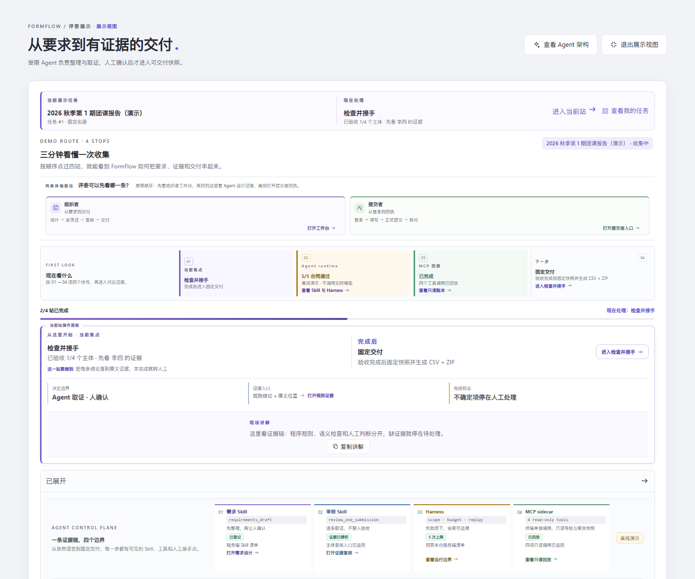

<div align="center">

# FormFlow · 收齐啦

### 把一份通知变成可执行、可核验的材料流程

FormFlow 是面向报名、征集和评审场景的材料工作台。它把通知、名单、模板和附件要求整理成收集任务，再把表单与多份材料变成带证据的逐项审核结果。

[观看 42 秒演示](https://github.com/user-attachments/assets/6863ce54-7200-4b48-8165-ab0b7f1cf460) · [评审快照 v0.1.0](https://github.com/strawberry-little-bear/FormFlow/releases/tag/v0.1.0) · [开始体验](#开始体验) · [产品文档](docs/README.md) · [部署与模型接入](docs/deployment.md) · [产品证据](docs/ux-review-index.md)

</div>



## 一条任务，从要求走到交付

通知里的人员范围、字段、附件格式、截止时间和验收标准，通常分散在不同文件里。FormFlow 把它们放进同一条流程：

1. 组织者上传通知、名单、模板和补充资料。
2. 需求 Agent 生成可编辑的收集蓝图，保留每条要求的来源，并指出冲突和待确认内容。
3. 组织者确认蓝图后发布任务；提交者填写信息、上传材料、保存草稿并正式提交。
4. 审核 Agent 对照已发布规则检查表单和多份文件，输出结论、证据位置和下一步动作。
5. 组织者处理需要人工确认的事项，随后导出 CSV 与 ZIP 交付快照。

## 两个 Agent

**需求 Agent** 把通知、名单、模板和自然语言说明整理成收集蓝图。蓝图包含适用对象、字段、材料槽位、格式要求、截止时间和跨文件核验规则。资料冲突或描述不清时，系统保留澄清问题，不把猜测直接变成正式要求。

**审核 Agent** 同时查看提交表单、组织者名单、已发布规则和多份材料，检查身份字段是否一致、文件属性是否符合要求、内容是否覆盖规则，以及文件之间是否存在矛盾。每条规则都有独立结论：

- `satisfied`：已有证据支持要求；
- `issue`：发现需要处理的问题；
- `unknown`：证据不足，需要人工判断；
- `failed`：检查过程没有完成。

结果会显示文件、页码或字段路径等证据线索，并区分提交者需要修改的内容与组织者需要确认的内容。

## Agent 如何受控运行

确定性程序负责文件类型、大小、数量、页数、字段格式、截止时间和导出条件；模型负责理解、比较和解释。Skill 固定 Agent 的工作步骤与输出格式，Harness 约束任务范围、工具、预算、超时、重试和人工接管，MCP 只提供受限的只读运行信息。

对于通知中明确提出的标题位置、对齐、页眉页脚或其他排版条件，蓝图可以声明视觉版式规则。此类规则必须使用支持原始 PDF/图片输入的模型；没有视觉输入或没有页面区域坐标时，结果会停在“检查未完成/无法判断”，不会把 OCR 文字当成版式证据。

文件审核默认优先使用部署者选择的模型的 PDF 或图片输入能力。模型或接口不支持原始文件、文件超限或调用失败时，`auto` 模式才回退到服务器文字解析；扫描件和无文字图片只有在允许时才使用 OCR。模型给出的证据位置是定位线索，组织者仍应打开原文完成最终核对。

FormFlow 不托管模型密钥。直接运行时，部署者可以把 API Key 放在本机 `.env` 或进程环境；Docker Compose 推荐使用仓库外的 `.formflow_llm_api_key` 文件型 Secret。应用不会把它写入数据库、浏览器响应、日志、审计事件或 MCP。启用真实模型后，材料是否发送给所选 provider 由部署者决定。

## 开始体验

演示人物、材料和结论均为虚构数据。不配置模型密钥也可以体验蓝图编辑、提交、失败恢复、人工接管和交付归档。

```bash
git clone https://github.com/strawberry-little-bear/FormFlow.git
cd FormFlow
python scripts/start_demo.py --reset
```

打开启动器显示的地址，使用演示账号：

```text
账号：demo
密码：demo1234
```

进入“需求设计”“收集工作台”“提交者端”“证据复核”和“交付与归档”，或按[体验指南](docs/demo-guide.md)走完组织者和提交者两条路径。

## 接入自己的模型

复制 `.env.example` 为 `.env`，填写兼容的 provider 地址、模型名称和 API Key：

```dotenv
FORMFLOW_LLM_BASE_URL=https://your-provider.example/v1
FORMFLOW_LLM_API_KEY=由部署者自行填写
FORMFLOW_LLM_MODEL=your-model
FORMFLOW_LLM_INPUT_MODE=auto
```

`auto` 优先尝试文件或图片直传；`direct` 只允许直传；`text` 只使用已有文字层；`ocr` 只走服务器解析和 OCR。第一次接入请使用获准的脱敏材料验证文件输入、证据定位、留存和费用政策。

## 文档入口

- [产品文档](docs/README.md)：按体验、能力、部署和证据场景阅读。
- [体验指南](docs/demo-guide.md)：沿组织者和提交者两条路径完成一项任务。
- [部署与模型接入](docs/deployment.md)：配置本地环境、provider、密钥和生产边界。
- [审核 Agent 评估集](docs/review-agent-evaluation.md)：在获准脱敏数据上评估结论和证据覆盖。
- [产品证据索引](docs/ux-review-index.md)：查看具体场景的页面结果、复现入口和限制。
- [2026-11-08 功能与视觉回归](docs/ux-review-2026-11-08/verification.md)：四档视口、关键路由和失败态的最新验收结果。

演示档案中的人物、材料和结论均为虚构。它们可以说明流程、权限、状态和导出行为，不能替代真实模型质量、敏感材料处理、屏幕阅读器、移动设备或公网安全验收。

项目使用 MIT License，详见 [LICENSE](LICENSE)。

**GitHub Topics**：`ai-agents` · `agentic-workflows` · `agent-skills` · `agent-harness` · `document-ai` · `document-review` · `cross-document-validation` · `evidence-based` · `human-in-the-loop` · `form-management` · `workflow-automation` · `mcp` · `openai-compatible` · `fastapi`
