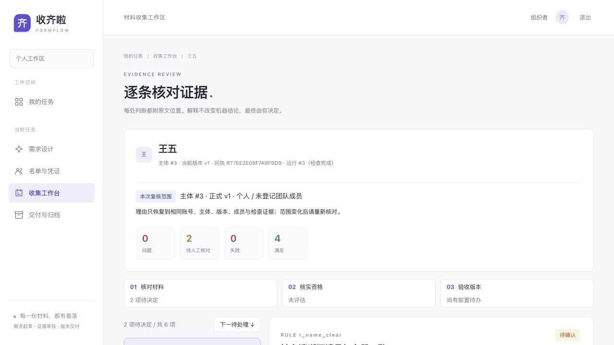

<div align="center">

# FormFlow · 收齐啦

### 每一份材料，都有着落。

从一句收集要求，到一份可追溯的交付包。
**要求可执行 · 补正有证据 · 人工有边界 · 交付按版本**

[快速开始](#快速开始) · [五分钟演示](docs/demo-guide.md) · [产品路线](docs/product-roadmap.md) · [交互与验收记录](docs/interaction-optimization.md)

</div>



> 当前为本地可演示的黑客松作品，已实现从发布要求、收件、检查、补正到人工验收及快照交付的核心闭环。尚未完成真实业务试点、模型质量评估和公网部署安全验收；截图与演示人物、材料均为虚构。

## 为什么做收齐啦

报名、团课报告、比赛材料……难点通常不在“做一张表单”，而在后面：**谁没交、谁要改、哪一版算数、最后交出去的是不是验收过的那一份？**

FormFlow 以一次「收集任务」为单位，把散落的要求变成结构化蓝图。组织者负责确认要求与最终判断，程序负责权限、版本与交付一致性，两个 Agent 协助整理要求、逐条找证据，而不是替人宣布“全部通过”。

### 一条完整工作流

| 步骤 | 你会看到什么 | 为什么重要 |
| --- | --- | --- |
| ① 说明要求 | 需求设计台：起草、澄清、历史版本、发布前差异核对 | 模型草案不直接发布，不暗加要求 |
| ② 安排收集 | 名单与凭证、开放报名入口、个人/团队主体 | 按稳定主体 ID 管理，不靠姓名猜权限 |
| ③ 填写与提交 | 默认完整表单、可选逐步引导、缺项定位、正式回执 | 上传 ≠ 保存草稿 ≠ 正式提交 |
| ④ 检查与补正 | 规则结果、原文位置、覆盖缺口、提交者解释 | “没读到”不能当成“确认缺失” |
| ⑤ 人工复核 | 规则决定、独立资格核实、单独验收当前版本 | 确认问题仍需补正；免交不等于验收 |
| ⑥ 交付归档 | 固定快照的 CSV 与 ZIP、排除原因、版本记录 | 打包期间的新提交不偷偷替换原包 |


## 两个 Agent，各守边界

```text
原始要求 ─→ 持久请求队列 → 需求 Agent → 蓝图草案 → 程序校验 + 人工确认发布
                                      │
字段 / 附件 ─→ 正式版本与回执 ─→ 后台 Worker
                                      │
                         确定性规则 + 审核 Agent
                                      │
                         逐条证据 / 未完成项 / 补正建议
                                      │
                         人工决定 → 资格核实 → 本版本验收
                                      │
                               固定快照 CSV + ZIP
```

- **需求 Agent**：把自然语言整理为字段、材料槽位、规则和时间策略；澄清不确定项。发布仍需人确认。
- **审核 Agent**：按已发布规则核对材料；语义结论须引用可定位的原文，证据不足为 `unknown`，技术失败为 `failed`。
- **程序**：管理私有访问、收件校验、幂等回执、不可变正式版本、截止判断、预算与快照。
- **人**：判断例外、核实资格、处置争议并验收。不做思想/文笔打分、资格真实性认定或 AI 写作检测。

## 这一轮的交互改进

- **理由刷新不丢**：规则理由、资格依据、验收依据独立暂存于本标签页，最长 7 天、最多 50 个复核范围。不是已提交决定，也不是跨设备服务器草稿；关闭标签页后不保证保留，退出登录清除。
- **旧理由不串用**：账号、任务、主体、正式修订、发布蓝图、登记成员及检查运行共同确定复核范围。范围变化后不自动恢复旧理由，旧页面提交返回冲突；存储不可用时明确提示刷新风险。
- **复核有顺序**：材料 → 资格 → 验收三步快捷入口；“下一待处理”保留当前输入，规则证据后紧接决定表单；规则很多时可切换“只看待处理”，处理完仍能回看全部历史。
- **决定不混淆**：“确认问题”保留补正待办；“人工核对通过 / 纠正误报 / 批准例外”只处置当前规则，之后仍需单独验收。
- **提交错误可定位**：缺项摘要跳到具体字段或附件；保存失败、版本冲突不会静默覆盖本地输入。
- **设计输入可恢复**：未发送的要求与澄清按账号、任务、蓝图基线隔离；发布前核对差异，阻止过时基线发布。

## 快速开始

### 1. 安装

本轮在 Python 3.12 验证；建议使用 Python 3.12。前端为原生 HTML/CSS/JavaScript，无需 Node 构建；Node 仅用于前端契约测试。

```bash
git clone https://github.com/strawberry-little-bear/FormFlow.git
cd FormFlow
python3 -m venv .venv
source .venv/bin/activate
pip install -r requirements.txt
```

### 2. 启动独立演示环境（无需模型密钥）

**种子脚本会重置同名演示任务、演示凭证及相关附件。不要对业务库执行。** 以下使用单独数据库和存储目录：

```bash
export FORMFLOW_DATABASE_URL="sqlite:///$PWD/data/demo/formflow.db"
export FORMFLOW_STORAGE_DIR="$PWD/data/demo/storage"
export FORMFLOW_LLM_API_KEY=''
python scripts/seed_demo.py
uvicorn app.main:app --host 127.0.0.1 --port 8000 --reload
```

浏览器打开 `http://127.0.0.1:8000/`。组织者：`demo / demo1234`；提交者使用种子脚本打印的对应虚构人物凭证。凭证是访问密钥，不要公开真实业务凭证。

**演示边界**：种子用脚本化模型预生成已有检查结果，可离线演示证据、人工决定、统计与交付。没有真实模型配置时，**AI 起草与新提交的语义审核不能完整工作**，不应把未完成检查演示成通过。

### 3. 新提交检查需要 Worker

API 负责可靠记录检查意图，Worker 才执行检查。另开终端，使用**同一个虚拟环境、数据库和存储目录**：

```bash
# 如果当前终端已经在 FormFlow 根目录，跳过 cd
cd /path/to/FormFlow
source .venv/bin/activate
export FORMFLOW_DATABASE_URL="sqlite:///$PWD/data/demo/formflow.db"
export FORMFLOW_STORAGE_DIR="$PWD/data/demo/storage"
export FORMFLOW_LLM_API_KEY=''
python -m app.worker
```

不开 Worker，新提交会停留在排队状态；需求 Agent 请求仍由 API 的后台任务尝试处理，页面会按同一请求编号查询状态。若 API 在排队后中断，页面轮询会重新触发仍排队的请求；Worker 重启时也会回收超过该环境模型调用上限的卡住任务。每个任务串行处理草案，旧版本冲突会停止而不覆盖新草案。无密钥时确定性检查仍可执行，语义检查明确记录未完成，而不是阻止收件或虚构全通过。

### 4. 可选：连接真实模型

在 `.env` 或环境变量中配置 `FORMFLOW_LLM_BASE_URL`、`FORMFLOW_LLM_API_KEY`、`FORMFLOW_LLM_MODEL`；兼容网关由你选择，`.env.example` 只是配置示例，不代表提供可用密钥或服务保证。**先取消上面显式设置的空密钥**（`unset FORMFLOW_LLM_API_KEY`），再重启 API 和 Worker。配置页数、OCR、调用和重试预算后，仅用授权的脱敏材料试验；模型调用可能向所选服务商发送材料内容并产生费用。

完整配置见 [`.env.example`](.env.example)。本地 API 文档：`http://127.0.0.1:8000/docs`。

## 五分钟看懂这个作品

种子状态：**名册 5 − 免交 1 = 应交 4；已正式提交 3、未正式提交 1、已验收 1**。待办不是互斥分组，不能简单相加。

1. 看工作台：张三已验收、李四待补正、王五待人工、赵六未提交、孙七免交。
2. 打开李四：期次错误有原文证据与补正建议，机器结果和人工决定分开。
3. 打开王五：写理由 → 刷新恢复 → 切规则/主体不会串用 → 单独处置规则后再验收。
4. 看交付：正式快照只纳入已验收版本；CSV、ZIP 引用同一快照。
5. 看需求设计：解释从要求到蓝图的过程、发布前差异核对和人工边界。

逐步讲解、演示前检查和失败兜底见 [演示指南](docs/demo-guide.md)。

## 工程与验证

**技术栈**：FastAPI · SQLAlchemy · SQLite/WAL · 原生前端 · PyMuPDF / python-docx · RapidOCR · OpenAI 兼容模型接口。当前为本地单 API + 单 Worker 原型，不宣称分布式队列或多 Worker 安全。

```text
app/agents/      需求起草、逐规则审核与受限审核 skill
app/agent_tools.py 工具 Schema、scope、预算、幂等与审计 harness
app/services/    收件、检查、人工决定、资格、统计和快照交付
app/api/         组织者 / 提交者权限隔离的 API
app/static/      五个工作区页面、表单与证据复核界面
app/worker.py    轮询检查与需求请求，恢复中断任务
app/services/agent_requests.py 持久需求队列、请求幂等与版本冲突保护
scripts/        虚构种子、解析样本、审核链路冒烟
tests/          业务不变量、权限、恢复和前端交互契约
docs/           产品方案、演示剧本、迭代记录与浏览器证据
```

```bash
python -m pytest -q
node --test tests/frontend_contracts.test.cjs
node --check app/static/app.js
python scripts/smoke_review.py --stub  # 本地脚本化审核，不调用真实模型
git diff --check
```

2026-10-22 可靠性与全链路走查：为需求 Agent 起草/修订增加持久状态队列、同请求 ID 幂等重试、刷新后先查询恢复、单任务串行和旧草案版本冲突保护；模型失败不生成空草案，用户原文与旧版本保留。独立虚构演示库由组织者创建任务、检查设计断连失败提示与刷新恢复、查看工作台/复核；虚构提交者上传合成 TXT、正式提交收据，语义检查因演示未配置密钥如实标为未完成并交组织者；组织者逐条人工确认并单独验收，再固定正式快照及生成 CSV/ZIP（下载接口分别返回 CSV/ZIP）。390px 桌面/手机关键页无横向溢出，控制台/errors 为空。累计自动化：**329 项 Python 测试、78 项 Node 前端契约测试通过**；离线 smoke_review、JS 语法、Python 编译、diff check 通过。全链路检查发现并补齐了正式回执中只显示编号、不显示所含附件的问题：回执附带当前不可变版本的材料清单；编辑区另标“本次编辑附件”，不把旧正式版本材料与当前更正草稿混淆。完整走查说明和截图见 [验收记录](docs/ux-review-2026-10-21/verification.md)。隔离新任务未调用实时模型；单条虚构规则的实时网关冒烟见早先记录，不声称模型准确率或真实用户收益。

## 安全、数据与当前边界

- `.env`、`data/` 和本地凭证不入库；附件私有存储，下载需鉴权。凭证为持有者权限，不是实名认证。
- 正式版本与历史决定保留；撤销追加记录，免交、资格、材料验收分别计算效力，不扩大到后续版本。
- 文件名净化、稳定 ID、防同名覆盖，CSV 防公式注入；文件内容仅作为待检查数据，不作为模型指令。
- 语义失败不丢件；未读页不是确认缺失；人工意见不改写原始机器证据。
- 催交通知目前**只生成可复制文案，不真实外发**。未发送输入不提供跨设备自动合并。
- 尚需补齐公网限流、上传隔离/恶意文件扫描、备份恢复演练、隐私与留存政策、目标用户试走及模型评估。不要直接用演示账号和原型配置公开承载真实材料。
- 现有依赖弃用与 SQLAlchemy 外键环警告仍待处理；许可证尚未确定，仓库未声明 MIT 等授权。

## 设计资料与协作

- [产品方案 v0.3](docs/收齐啦产品设计方案_v0.3.docx) / [提取文本](docs/plan_extracted.txt)：设计基线，不是完成证明。
- [产品路线与验收标准](docs/product-roadmap.md)：下一轮按人能否顺利完成任务推进，不盲目堆功能。
- [交互修复记录](docs/interaction-optimization.md)：历史进展、自动化与浏览器验证分开记录。

按项目约定**仅在 `main` 开发**，开始和提交前同步远端；不创建额外功能分支、不强推、不改写已发布历史。提交身份为 `strawberry-little-bear`，邮箱 `182593643+strawberry-little-bear@users.noreply.github.com`。
